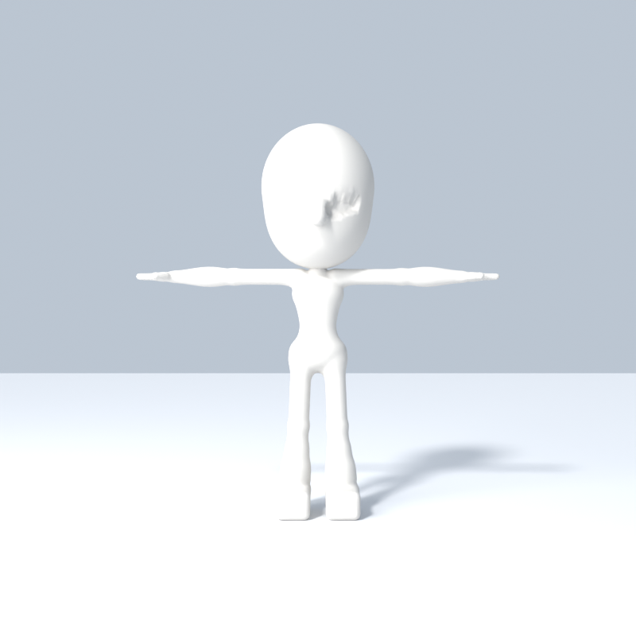
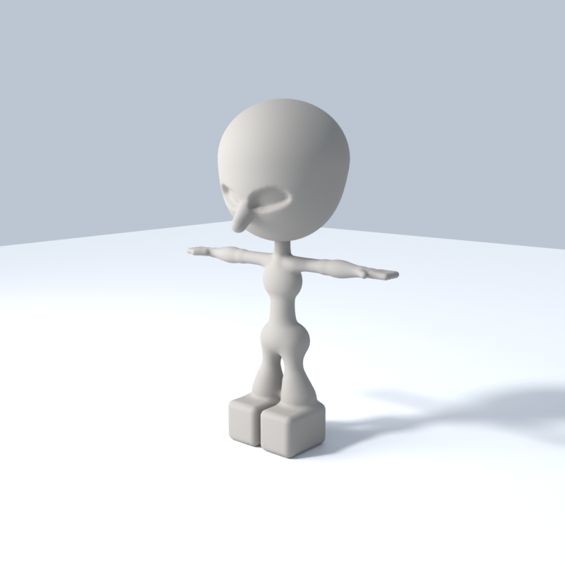
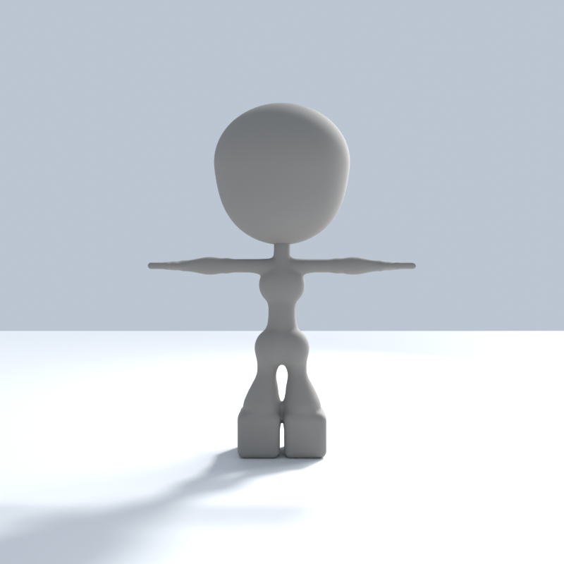

# Android-3D-Model-Forge

Create **real, downloadable 3D models from your phone.** Blender runs in the cloud on GitHub Actions,
builds the model with Python, checks it automatically, and hands you a `.glb` (plus an editable `.blend`).
No PC, no local Blender, no API keys, no paid services.

<p align="center">
  
  
</p>
<p align="center"><i>"Forge Kid" (<code>chibi_humanoid</code>) — generated, rigged, validated and rendered by Blender 4.2 LTS inside GitHub Actions.</i></p>

<p align="center">
  
  
  
</p>
<p align="center">
  
  
  
</p>
<p align="center"><i>"Gorilla" (<code>gorilla</code>) — carved from the owner's turnaround sheet (img2threejs visual-hull method) and textured with the drawing itself.</i></p>

<p align="center"><i>"Clay Chibi" (<code>clay_chibi</code>) — a one-piece, sculpt-style base mesh with carved eye sockets, fingers and block boots.</i></p>

## Download the example models

| Model | GLB (rigged, for viewers/engines) | BLEND (editable) | Report |
|---|---|---|---|
| Forge Kid | [forge-kid.glb](https://github.com/smitnk/Android-3D-Model-Forge/releases/download/model-latest/forge-kid.glb) | [forge-kid.blend](https://github.com/smitnk/Android-3D-Model-Forge/releases/download/model-latest/forge-kid.blend) | [report](docs/preview/forge-kid-REPORT.md) |
| Gorilla | [gorilla.glb](https://github.com/smitnk/Android-3D-Model-Forge/releases/download/model-latest/gorilla.glb) | [gorilla.blend](https://github.com/smitnk/Android-3D-Model-Forge/releases/download/model-latest/gorilla.blend) | [report](docs/preview/gorilla-REPORT.md) |
| Clay Chibi | [clay-chibi.glb](https://github.com/smitnk/Android-3D-Model-Forge/releases/download/model-latest/clay-chibi.glb) | [clay-chibi.blend](https://github.com/smitnk/Android-3D-Model-Forge/releases/download/model-latest/clay-chibi.blend) | [report](docs/preview/clay-chibi-REPORT.md) |

These files live on the [`model-latest` Release](https://github.com/smitnk/Android-3D-Model-Forge/releases/tag/model-latest)
and are replaced each time a new model is published.

## Features

- **Three generators**, picked with the `model_type` option:
  - `gorilla` — carved from a turnaround sheet: T-pose front silhouette x side-view depth (`scripts/hull.py`),
    voxel-remeshed to even quads, with the T-pose front/back drawings projected on as the texture.
  - `clay_chibi` — one-piece sculpt-style base mesh built from metaballs: big round head with carved angry eye sockets
    and a pointed nose, slim body, fingers, flared legs and block boots, blended skin weights.
  - `chibi_humanoid` — dressed cartoon character — oversized head, face (eyes, pupils, brows, nose, mouth, ears),
  spiky hair, shirt, shorts, arms, hands with thumbs, legs, shoes. ~42 parts, ~25k triangles, 10 materials.
- **Always a T-pose** — enforced by the generator and re-checked on the exported file.
- **Rigged** — 17-bone humanoid skeleton with skinning that survives GLB export (rigid per-part weights; see limitations).
- **Customisable colours** for skin, hair, shirt and shorts from the Run-workflow form.
- **Exports**: GLB (always) and BLEND (optional).
- **Automatic validation** — 35 checks on the exported GLB: file structure, geometry, materials, scale, grounding,
  centring, symmetry, T-pose, facing direction, proportions, skeleton and skinning.
- **Real preview renders** (Cycles on CPU) with an automatic "nothing is cut off" framing check.
- **Reusable AI-agent skill** in [`skills/android-3d-model-forge`](skills/android-3d-model-forge/SKILL.md).

## Make a model from your Android phone

1. Open this repository in your phone's browser (Chrome works; tap **⋮ → Desktop site** if a button is hidden).
2. Tap the **Actions** tab.
3. Tap **Generate 3D Model** (on mobile you may need to tap **All workflows** first).
4. Tap **Run workflow**. Pick a **model type** (`chibi_humanoid`, `clay_chibi` or `gorilla`). Change the name or colours if you like (colours are `#RRGGBB`, e.g. `#2E9E5B`).
   Tick **publish** if you want it to replace the example above. Tap the green **Run workflow** button.
5. Wait 3–6 minutes. Refresh; when the run shows a green ✓, tap it.
6. The **Summary** page shows the model report. Scroll down to **Artifacts** and tap `model-<number>`.
7. A ZIP downloads. Open it with your Files app; inside are `<name>.glb`, `<name>.blend`, two preview PNGs and the reports.
8. Open the `.glb` with any glTF/3D viewer app, or upload it to a browser-based glTF viewer.

**Artifacts are deleted after 30 days.** For a permanent link, run with **publish** ticked: the files go to the
`model-latest` Release (stable URLs like the ones above) and the previews here update automatically.

## T-pose policy

Every humanoid this project generates is in a **neutral, symmetrical T-pose**: upright, facing forward, arms straight
out horizontally from the shoulders, straight elbows, straight parallel legs, feet pointing forward, standing on the
ground at the origin. There is deliberately no option to change it — posing belongs to the rig, not the rest model.
The validator fails any model whose arms are more than 8° from horizontal (so an A-pose fails), and it also checks
the skeleton's rest-pose bone directions.

## How it works

```
Run workflow (phone) ──► GitHub Actions (ubuntu-24.04, no GPU)
                           ├─ download pinned Blender 4.2.3 LTS (cached, checksum-verified)
                           ├─ blender -b … generate_model.py   build parts → rig → self-checks → GLB/BLEND → renders
                           ├─ glb_inspect.py                   pure-Python GLB structure check
                           ├─ blender -b … validate_model.py   re-import GLB in a clean scene → 35 checks
                           ├─ make_report.py                   REPORT.md → run Summary page
                           ├─ upload artifact (30 days)
                           └─ publish (optional) → model-latest Release + docs/preview/
```

## Repository structure

```
.github/workflows/generate-model.yml   Main workflow (generate, validate, upload, publish)
.github/workflows/validate-model.yml   Fast checks without Blender (+ optional check of the released GLB)
scripts/generate_model.py              Procedural character + rig (Blender)
scripts/export_model.py                GLB/BLEND export, preview rendering (Blender)
scripts/validate_model.py              Validation of the exported GLB (Blender)
scripts/glb_inspect.py                 GLB parser, no dependencies
scripts/make_report.py                 Markdown report
skills/android-3d-model-forge/         Reusable skill for AI coding agents
docs/preview/                          Published previews + report (written by CI)
tests/                                 Unit tests (run in CI)
models/ examples/ assets/              Notes on where models live, example inputs, asset policy
```

## Use the AI-agent skill

`skills/android-3d-model-forge/SKILL.md` follows the Agent Skills layout (`SKILL.md` with `name`/`description`
frontmatter + `references/`). Copy the folder into your agent's skills directory (for Claude Code:
`.claude/skills/`), or simply tell any coding agent to read it. It needs no MCP server or API key.
See [the skill README](skills/android-3d-model-forge/README.md).

## Vendored skill: blender-kiln

[`skills/blender-kiln`](skills/blender-kiln/VENDORED.md) is a copy of the MIT-licensed
[elithril/blender-kiln](https://github.com/elithril/blender-kiln) 3D-asset pipeline skill. It normally drives Blender
through a Blender MCP add-on on a PC; here we use its **reference-fidelity** method (inventory → measure the
silhouette → attach every part → review against the reference) inside the cloud workflow. See `VENDORED.md`.

## Vendored skill: img2threejs

[`skills/img2threejs`](skills/img2threejs/VENDORED.md) is a copy of the Apache-2.0
[img2threejs](https://github.com/img2threejs/img2threejs) skill. Its visual-hull and projected-texture ideas
power the `gorilla` generator (`scripts/hull.py`, `scripts/gorilla.py`); its browser-based Three.js pipeline is not
run in CI.

## Add a new model type

1. In `scripts/generate_model.py`, add the type to `--model-type` choices and write a `build_<type>()` that returns
   parts made with `part()` and materials made with `material()`.
2. Add the same option to the `model_type` input in `generate-model.yml`.
3. Humanoids must reuse the T-pose construction and bone names. Non-humanoids need their own expected-parts list
   in `validate_model.py`.
4. Run the workflow and read the report. Only document the type as working after a green run.

Details: [modeling guidelines](skills/android-3d-model-forge/references/modeling-guidelines.md),
[export guidelines](skills/android-3d-model-forge/references/export-guidelines.md).

## Validation and troubleshooting

- A run is only green if **every** validation check passes; failed checks are printed as `[FAIL] …` in the
  *Validate model* step and listed in the Summary.
- Each run also writes `logs.txt`, `generation.json` and `validation.json` to the
  [`ci-results`](https://github.com/smitnk/Android-3D-Model-Forge/tree/ci-results/latest) branch.
- *Download pinned Blender* failed → re-run (temporary network issue).
- *Generate model* failed with a colour error → use `#RRGGBB` format.
- A check like `tpose_arm_horizontal_L` failed after editing geometry → fix the geometry; don't relax the threshold.

## Known limitations and plans

- Three generators so far (`chibi_humanoid`, `clay_chibi`, `gorilla`). The gorilla is shaped from two views (front + side), so concavities no silhouette shows are carried only by the texture; side-facing surfaces show some texture stretching; no expressions or action poses yet. Creatures, props and clothing variants are planned.
- `chibi_humanoid` skinning is **rigid per part** (each part follows one bone); `clay_chibi` uses blended
  distance-based weights, which bend more smoothly but are not hand-painted production weights.
- No image-to-3D / AI reconstruction yet. It will be an optional integration and won't be claimed until tested.
- No animations are exported yet.

## License

Scripts and docs: [MIT](LICENSE). Blender is downloaded at build time and is GPL; see
[THIRD_PARTY_LICENSES.md](THIRD_PARTY_LICENSES.md). No third-party models, textures or character designs are included.
