# Android-3D-Model-Forge

Create **real, downloadable 3D models from your phone.** Blender runs in the cloud on GitHub Actions,
builds the model with Python, checks it automatically, and hands you a `.glb` (plus an editable `.blend`).
No PC, no local Blender, no API keys, no paid services.

<p align="center">
  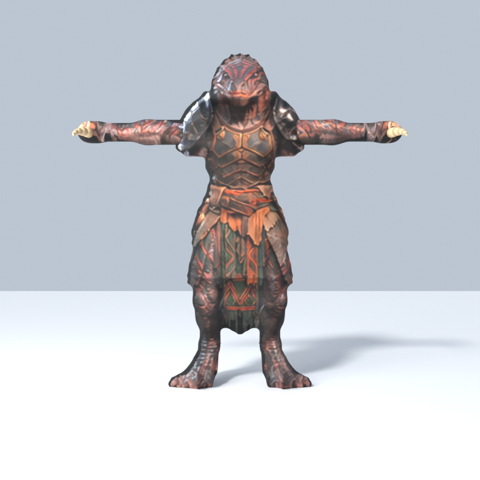
  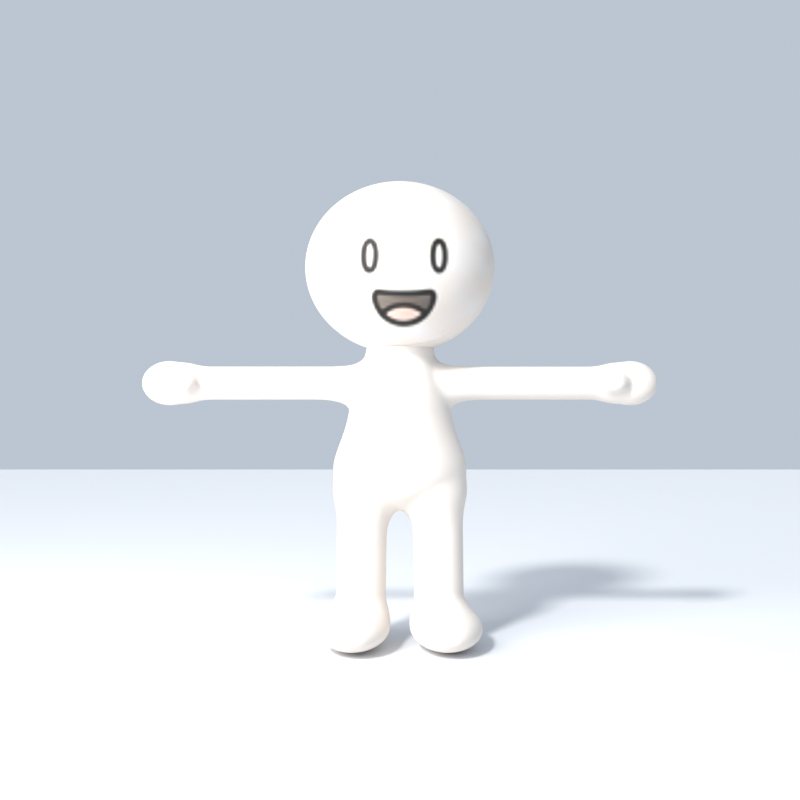
  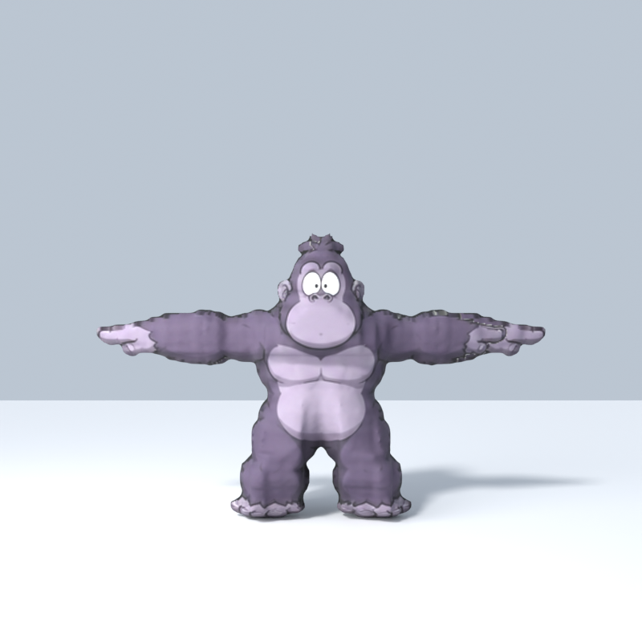
  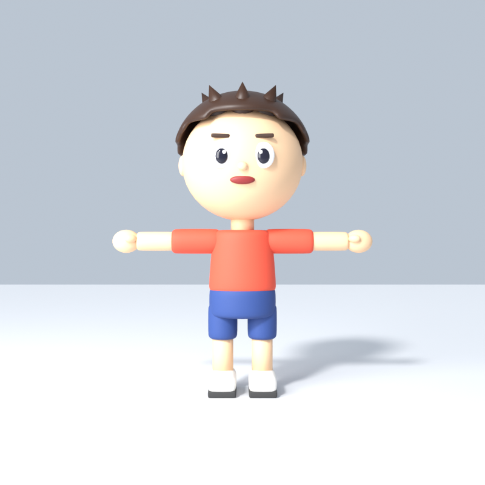
</p>
<p align="center"><i>Round Buddy, Gorilla and Forge Kid — generated, rigged, validated and rendered by Blender 4.2 LTS inside GitHub Actions.</i></p>

## Model gallery — download and check

| | Model | Download (ZIP: GLB + BLEND + previews + report) | Single files |
|---|---|---|---|
|  | **Lizard Warrior** — carved from a 12-view turnaround (wireframe row for shape, textured row for colour), T-pose arms, bone daggers | [lizard-warrior.zip](https://github.com/smitnk/Android-3D-Model-Forge/releases/download/model-latest/lizard-warrior.zip) | [GLB](https://github.com/smitnk/Android-3D-Model-Forge/releases/download/model-latest/lizard-warrior.glb) · [BLEND](https://github.com/smitnk/Android-3D-Model-Forge/releases/download/model-latest/lizard-warrior.blend) · [report](docs/preview/lizard-warrior-REPORT.md) |
|  | **Round Buddy** — built from a 24-view turnaround sheet: measured proportions, T-pose arms, face projected from the drawing | [round-buddy.zip](https://github.com/smitnk/Android-3D-Model-Forge/releases/download/model-latest/round-buddy.zip) | [GLB](https://github.com/smitnk/Android-3D-Model-Forge/releases/download/model-latest/round-buddy.glb) · [BLEND](https://github.com/smitnk/Android-3D-Model-Forge/releases/download/model-latest/round-buddy.blend) · [report](docs/preview/round-buddy-REPORT.md) |
| 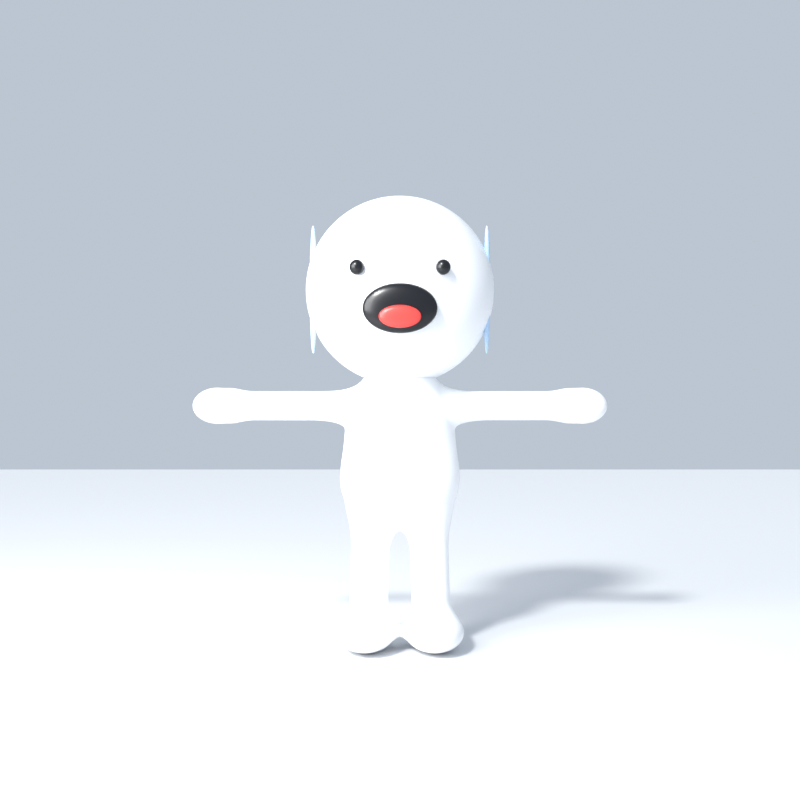 | **Snow Buddy** — white round cartoon character with dot eyes, open smile and red tongue, generated from procedural geometry | [snow-buddy.zip](https://github.com/smitnk/Android-3D-Model-Forge/releases/download/model-latest/snow-buddy.zip) | [GLB](https://github.com/smitnk/Android-3D-Model-Forge/releases/download/model-latest/snow-buddy.glb) · [BLEND](https://github.com/smitnk/Android-3D-Model-Forge/releases/download/model-latest/snow-buddy.blend) · [report](docs/preview/snow-buddy-REPORT.md) |
|  | **Gorilla** — carved from a turnaround sheet (visual hull), drawing projected as texture, 17-bone rig | [gorilla.zip](https://github.com/smitnk/Android-3D-Model-Forge/releases/download/model-latest/gorilla.zip) | [GLB](https://github.com/smitnk/Android-3D-Model-Forge/releases/download/model-latest/gorilla.glb) · [BLEND](https://github.com/smitnk/Android-3D-Model-Forge/releases/download/model-latest/gorilla.blend) · [report](docs/preview/gorilla-REPORT.md) |
|  | **Forge Kid** — the first character: dressed chibi, 17-bone rig | [forge-kid.zip](https://github.com/smitnk/Android-3D-Model-Forge/releases/download/model-latest/forge-kid.zip) | [GLB](https://github.com/smitnk/Android-3D-Model-Forge/releases/download/model-latest/forge-kid.glb) · [BLEND](https://github.com/smitnk/Android-3D-Model-Forge/releases/download/model-latest/forge-kid.blend) · [report](docs/preview/forge-kid-REPORT.md) |

**Check a model on Android:** download the ZIP, open it in your Files app, and open the `.glb` with any glTF / 3D
viewer app (or a web glTF viewer). The ZIP also has front, three-quarter and back renders and the validation report.
All files live on the [`model-latest` Release](https://github.com/smitnk/Android-3D-Model-Forge/releases/tag/model-latest) and are
replaced each time a model is published.

<details><summary>More views</summary>

<p align="center">
  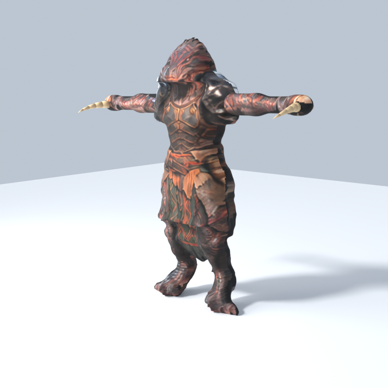
  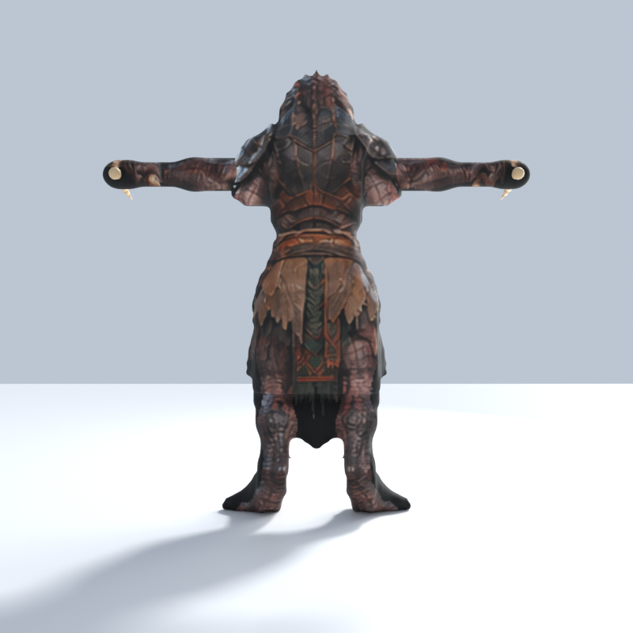
</p>
<p align="center">
  
  
</p>
<p align="center">
  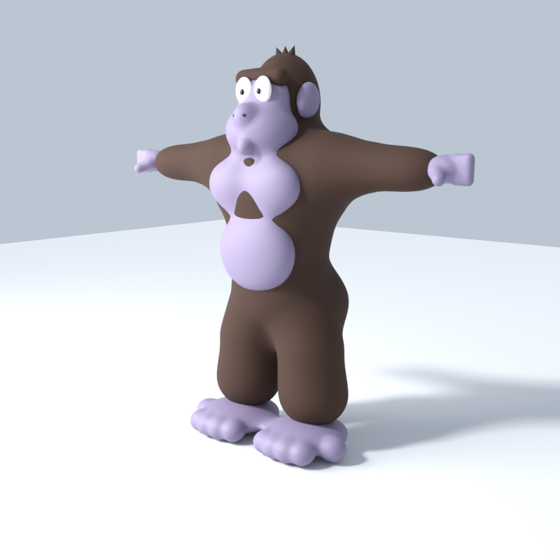
  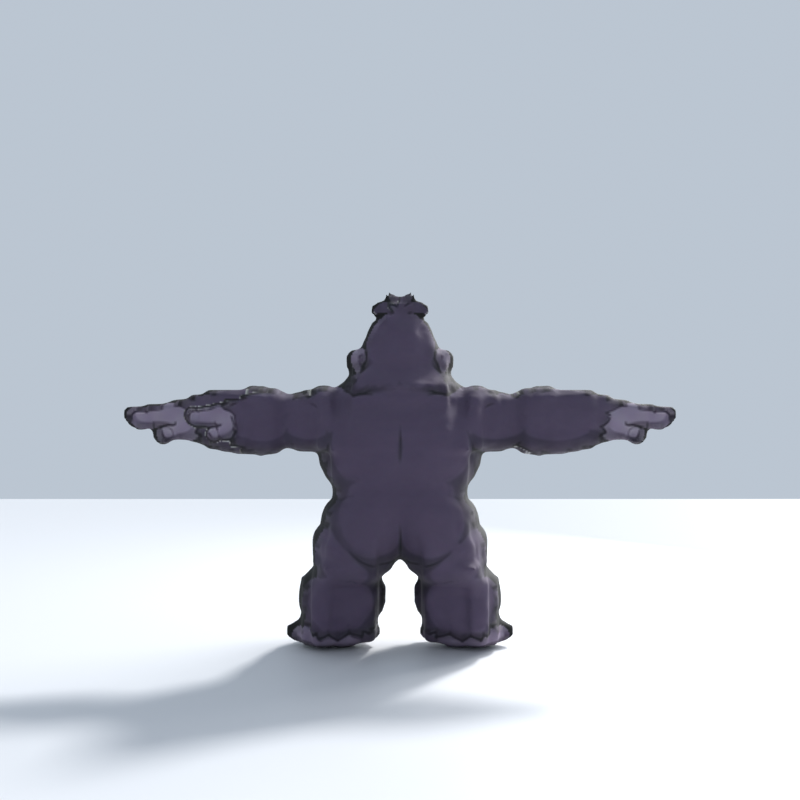
</p>
<p align="center">
  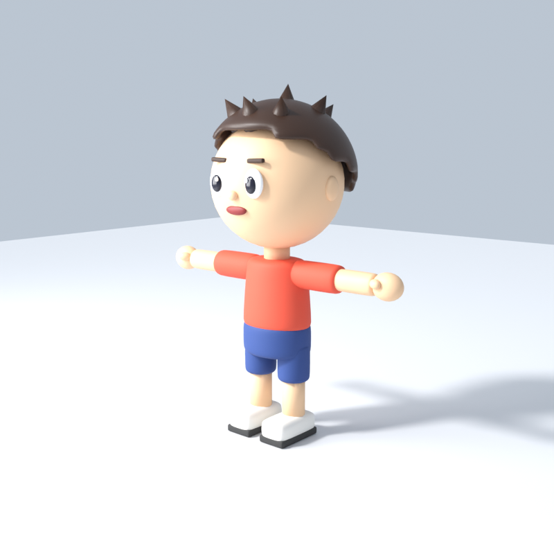
  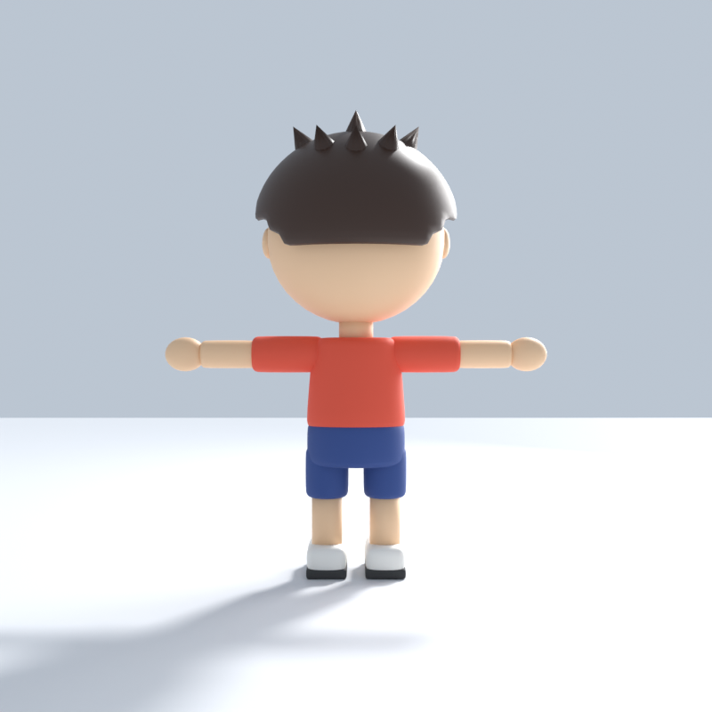
</p>
</details>

## Make your own character with Claude (or any AI coding agent)

You need only a GitHub account and a phone or browser. The AI writes the generator; GitHub runs Blender.

1. **Get your own copy.** Open this repository on GitHub and tap **Fork** (or, on a PC, `git clone
   https://github.com/smitnk/Android-3D-Model-Forge`). In your copy, open **Actions** and tap **Enable workflows**.
2. **Prepare a reference.** The best input is a turnaround / model sheet of your *own* (or AI-generated, original)
   character: a front view and a 90° side view, ideally also a T-pose and a back view. One front image also works;
   the AI will tell you what it had to assume.
3. **Open your AI agent on your copy.**
   - **Claude** (claude.ai or the Claude app with code access, or Claude Code): connect GitHub, attach your copy of
     the repository and the reference image.
   - **Any other agent** (Codex, Cursor, Gemini CLI, Copilot agent, OpenCode, …): open your copy as the workspace and
     attach the image. Nothing here is Claude-specific.
4. **Give it this prompt** (edit the name):

   > Read `skills/android-3d-model-forge/SKILL.md`, `skills/img2threejs/SKILL.md` and
   > `skills/blender-kiln/references/reference-fidelity.md`. Build a new generator `scripts/<name>.py` for the
   > character in the attached image: crop the views into `assets/reference/<name>/` with alpha masks, measure the
   > proportions from the pixels, build the model in a T-pose, register the type in `generate_model.py`,
   > `validate_model.py` and the workflow, push to `main`, read the CI result on the `ci-results` branch,
   > fix any failure, compare the previews with the reference, and add the model to the README gallery.

5. **Wait for the cloud build** (~5 minutes). A push builds **only the model whose own files changed**
   (`scripts/<name>.py` or `assets/reference/<name>/`): Blender builds it, checks it (T-pose, scale, symmetry, rig,
   file structure) and publishes it. Changes to shared code build nothing unless the commit message says
   `[build: <name>]` or `[build-all]`; a manual **Run workflow** builds the model you pick.
6. **Download** your model from the gallery / Release (ZIP with GLB + BLEND), or from the run's **Artifacts**.
7. **Iterate:** tell the agent what looks wrong ("head too small", "feet too flat"); it edits the generator and
   pushes again.

Patterns the agent can copy: `scripts/round_buddy.py` (measured shapes + projected face), `scripts/gorilla.py`
(silhouette carving + projected drawing, for sheets with T-pose and side views), `generate_model.py` → `build_character`
(multi-part dressed character). Only use characters you have the rights to.

## Experimental: AI template with TripoSR (free, CPU)

**Actions → AI Template (TripoSR, CPU) → Run workflow** turns one prepared image (gray background, figure centred,
e.g. `assets/ai-input/lizard-warrior.png`) into a rough textured 3D mesh in about a minute on GitHub's free runner
(peak ~3.7 GB RAM, no GPU). The mesh is one fused surface in the pose of the image: useful as a 3D reference for
building a proper model, not a finished, rigged character. Result: the run's artifact and
[`ci-results/latest/triposr`](https://github.com/smitnk/Android-3D-Model-Forge/tree/ci-results/latest/triposr).

## Features

- **Generators**, picked with the `model_type` option:
  - `gorilla` — carved from a turnaround sheet: T-pose front silhouette x side-view depth (`scripts/hull.py`),
    voxel-remeshed to even quads, with the T-pose front/back drawings projected on as the texture.
  - `round_buddy` — soft cartoon figure measured from a turnaround sheet, face projected from the drawing.
  - `chibi_humanoid` — dressed cartoon character — oversized head, face (eyes, pupils, brows, nose, mouth, ears),
  spiky hair, shirt, shorts, arms, hands with thumbs, legs, shoes. ~42 parts, ~25k triangles, 10 materials.
- **Always a T-pose** — enforced by the generator and re-checked on the exported file.
- **Rigged** — 17-bone humanoid skeleton with skinning that survives GLB export (rigid per-part weights; see limitations).
- **Customisable colours** for skin, hair, shirt and shorts from the Run-workflow form.
- **Exports**: GLB (always) and BLEND (optional).
- **Automatic validation** — 35 checks on the exported GLB: file structure, geometry, materials, scale, grounding,
  centring, symmetry, T-pose, facing direction, proportions, skeleton and skinning.
- **Real preview renders** (Cycles on CPU) with an automatic "nothing is cut off" framing check.
- **Reusable AI-agent skill** in [`skills/android-3d-model-forge`](skills/android-3d-model-forge/SKILL.md).

## Make a model from your Android phone

1. Open this repository in your phone's browser (Chrome works; tap **⋮ → Desktop site** if a button is hidden).
2. Tap the **Actions** tab.
3. Tap **Generate 3D Model** (on mobile you may need to tap **All workflows** first).
4. Tap **Run workflow**. Pick a **model type** (`chibi_humanoid`, `gorilla` or `round_buddy`). Change the name or colours if you like (colours are `#RRGGBB`, e.g. `#2E9E5B`).
   Tick **publish** if you want it to replace the example above. Tap the green **Run workflow** button.
5. Wait 3–6 minutes. Refresh; when the run shows a green ✓, tap it.
6. The **Summary** page shows the model report. Scroll down to **Artifacts** and tap `model-<number>`.
7. A ZIP downloads. Open it with your Files app; inside are `<name>.glb`, `<name>.blend`, two preview PNGs and the reports.
8. Open the `.glb` with any glTF/3D viewer app, or upload it to a browser-based glTF viewer.

**Artifacts are deleted after 30 days.** For a permanent link, run with **publish** ticked: the files go to the
`model-latest` Release (stable URLs like the ones above) and the previews here update automatically.

## T-pose policy

Every humanoid this project generates is in a **neutral, symmetrical T-pose**: upright, facing forward, arms straight
out horizontally from the shoulders, straight elbows, straight parallel legs, feet pointing forward, standing on the
ground at the origin. There is deliberately no option to change it — posing belongs to the rig, not the rest model.
The validator fails any model whose arms are more than 8° from horizontal (so an A-pose fails), and it also checks
the skeleton's rest-pose bone directions.

## How it works

```
Run workflow (phone) ──► GitHub Actions (ubuntu-24.04, no GPU)
                           ├─ download pinned Blender 4.2.3 LTS (cached, checksum-verified)
                           ├─ blender -b … generate_model.py   build parts → rig → self-checks → GLB/BLEND → renders
                           ├─ glb_inspect.py                   pure-Python GLB structure check
                           ├─ blender -b … validate_model.py   re-import GLB in a clean scene → 35 checks
                           ├─ make_report.py                   REPORT.md → run Summary page
                           ├─ upload artifact (30 days)
                           └─ publish (optional) → model-latest Release + docs/preview/
```

## Repository structure

```
.github/workflows/generate-model.yml   Main workflow (generate, validate, upload, publish)
.github/workflows/validate-model.yml   Fast checks without Blender (+ optional check of the released GLB)
scripts/generate_model.py              Procedural character + rig (Blender)
scripts/export_model.py                GLB/BLEND export, preview rendering (Blender)
scripts/validate_model.py              Validation of the exported GLB (Blender)
scripts/glb_inspect.py                 GLB parser, no dependencies
scripts/make_report.py                 Markdown report
skills/android-3d-model-forge/         Reusable skill for AI coding agents
docs/preview/                          Published previews + report (written by CI)
tests/                                 Unit tests (run in CI)
models/ examples/ assets/              Notes on where models live, example inputs, asset policy
```

## Use the AI-agent skill

`skills/android-3d-model-forge/SKILL.md` follows the Agent Skills layout (`SKILL.md` with `name`/`description`
frontmatter + `references/`). Copy the folder into your agent's skills directory (for Claude Code:
`.claude/skills/`), or simply tell any coding agent to read it. It needs no MCP server or API key.
See [the skill README](skills/android-3d-model-forge/README.md).

## Vendored skill: blender-kiln

[`skills/blender-kiln`](skills/blender-kiln/VENDORED.md) is a copy of the MIT-licensed
[elithril/blender-kiln](https://github.com/elithril/blender-kiln) 3D-asset pipeline skill. It normally drives Blender
through a Blender MCP add-on on a PC; here we use its **reference-fidelity** method (inventory → measure the
silhouette → attach every part → review against the reference) inside the cloud workflow. See `VENDORED.md`.

## Vendored skill: img2threejs

[`skills/img2threejs`](skills/img2threejs/VENDORED.md) is a copy of the Apache-2.0
[img2threejs](https://github.com/img2threejs/img2threejs) skill. Its visual-hull and projected-texture ideas
power the `gorilla` generator (`scripts/hull.py`, `scripts/gorilla.py`); its browser-based Three.js pipeline is not
run in CI.

## Add a new model type

1. In `scripts/generate_model.py`, add the type to `--model-type` choices and write a `build_<type>()` that returns
   parts made with `part()` and materials made with `material()`.
2. Add the same option to the `model_type` input in `generate-model.yml`.
3. Humanoids must reuse the T-pose construction and bone names. Non-humanoids need their own expected-parts list
   in `validate_model.py`.
4. Run the workflow and read the report. Only document the type as working after a green run.

Details: [modeling guidelines](skills/android-3d-model-forge/references/modeling-guidelines.md),
[export guidelines](skills/android-3d-model-forge/references/export-guidelines.md).

## Validation and troubleshooting

- A run is only green if **every** validation check passes; failed checks are printed as `[FAIL] …` in the
  *Validate model* step and listed in the Summary.
- Each run also writes `logs.txt`, `generation.json` and `validation.json` to the
  [`ci-results`](https://github.com/smitnk/Android-3D-Model-Forge/tree/ci-results/latest) branch.
- *Download pinned Blender* failed → re-run (temporary network issue).
- *Generate model* failed with a colour error → use `#RRGGBB` format.
- A check like `tpose_arm_horizontal_L` failed after editing geometry → fix the geometry; don't relax the threshold.

## Known limitations and plans

- Main generators: `chibi_humanoid`, `gorilla`, `round_buddy` (`clay_chibi` remains as an unpublished example). The gorilla is shaped from two views (front + side), so concavities no silhouette shows are carried only by the texture; side-facing surfaces show some texture stretching; no expressions or action poses yet. Creatures, props and clothing variants are planned.
- `chibi_humanoid` skinning is **rigid per part** (each part follows one bone); `gorilla` and `round_buddy` use blended
  distance-based weights, which bend more smoothly but are not hand-painted production weights.
- No image-to-3D / AI reconstruction yet. It will be an optional integration and won't be claimed until tested.
- No animations are exported yet.

## License

Scripts and docs: [MIT](LICENSE). Blender is downloaded at build time and is GPL; see
[THIRD_PARTY_LICENSES.md](THIRD_PARTY_LICENSES.md). No third-party models, textures or character designs are included.
